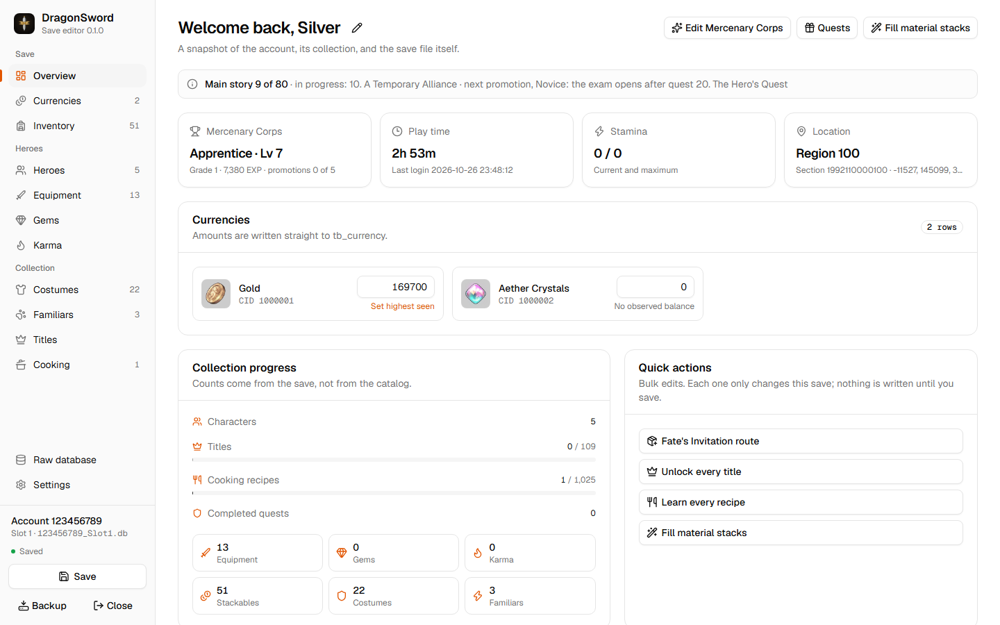
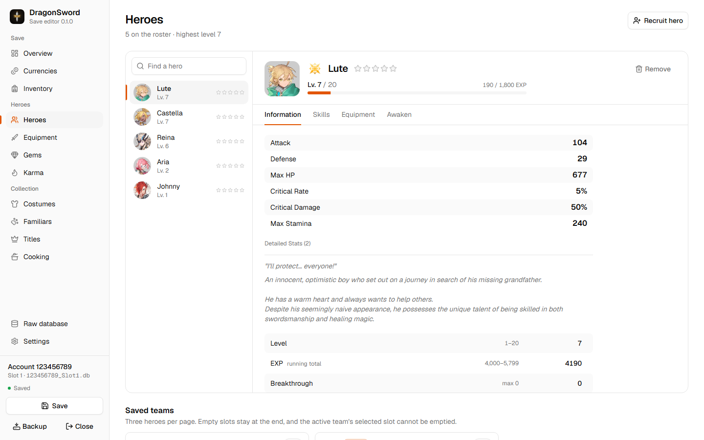
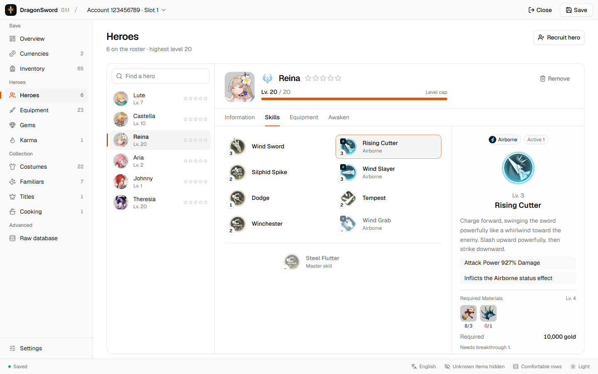
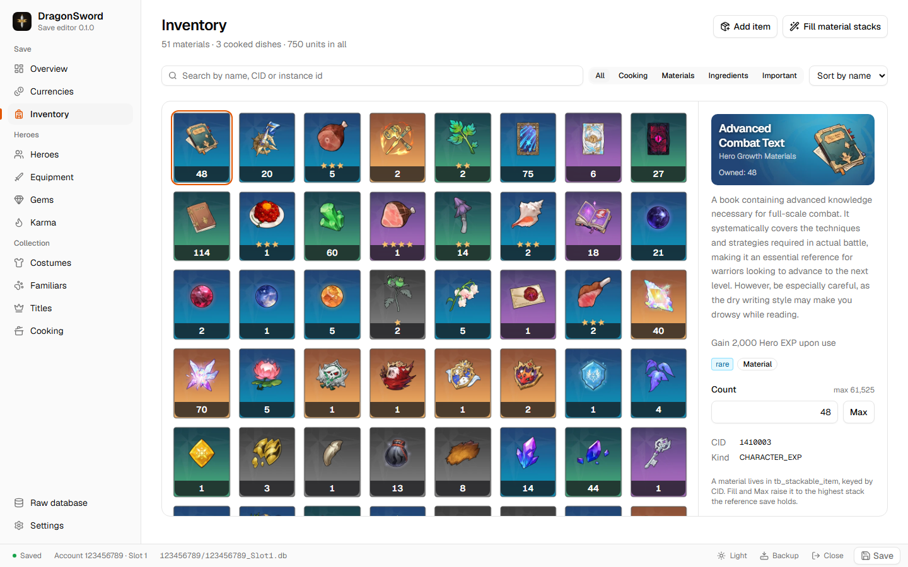

# DragonSword Save Editor

A desktop save editor for **DragonSword Awakening**. Open a save slot, change your heroes, gear, items, currencies and collections on screens laid out like the game's own menus, and write it back with a backup of the original.

<picture>
  <source media="(prefers-color-scheme: dark)" srcset="docs/images/overview-dark.png">
  
</picture>

## Features

- **Heroes**: level, EXP, breakthrough, transcendence and skills within the game's own caps, with the stats, skill damage and outfit portraits the game shows. Recruit any of the 19 heroes the game hands out.
- **Gear**: enchant level, stat rolls, gems, karma and familiars, each named and valued with the game's tables, with set bonuses and the hero wearing it.
- **Inventory**: the game's bag tabs, grades and item cards; edit counts, add items, or fill every material stack at once.
- **Currencies and collections**: gold and aether crystals, costumes, familiars, all 109 titles and all 1,025 cooking recipes.
- **Raw database**: every table and column of the save, one type-checked cell at a time, for anything the screens don't cover.
- **Safe writes**: nothing is written until you save, the original is backed up first, and a write is refused if the game changed the file or left it half-saved.
- **Offline**: no network, accounts, telemetry or updates.

<table>
  <tr>
    <td width="33%">
      <picture>
        <source media="(prefers-color-scheme: dark)" srcset="docs/images/hero-dark.png">
        
      </picture>
    </td>
    <td width="33%">
      <picture>
        <source media="(prefers-color-scheme: dark)" srcset="docs/images/skills-dark.png">
        
      </picture>
    </td>
    <td width="33%">
      <picture>
        <source media="(prefers-color-scheme: dark)" srcset="docs/images/inventory-dark.png">
        
      </picture>
    </td>
  </tr>
</table>

## Install

Download `dragonsword-save-editor-v<version>-windows-x64-setup.exe` from the [latest release](https://github.com/lordsilver/dragonsword-save-editor/releases/latest) and run it. It installs for you alone or for everyone on the PC; the `.msi` from the same release installs for everyone, and the `.zip` holds the app on its own, to run without installing (Windows 10 and 11 already have the WebView2 runtime it needs). With [mise](https://mise.jdx.dev), `mise use github:lordsilver/dragonsword-save-editor` installs the portable build. The installers are not code-signed, so SmartScreen asks once: **More info**, then **Run anyway**.

## How to use

1. Close the game. A running game keeps the save open and can overwrite your changes.
2. Start the editor, choose **Scan a folder** and pick your `SaveGames` folder, then open a slot. Saves live in `%LOCALAPPDATA%\DragonSword Awakening\DS\Saved\SaveGames\<account>\<account>_Slot<N>.db`.
3. Make your changes. They stay in the editor until you save.
4. Press **Save** (<kbd>Ctrl</kbd>+<kbd>S</kbd>). The first save backs up the original beside it as `<save>.<timestamp>.bak`.
5. Start the game and load the slot.

To undo everything, close the editor and copy the `.bak` back over the save.

## Documentation

- [User guide](docs/guide.md): every screen, value limits, backups and recovery, troubleshooting and limitations.
- [Save format](docs/save-format.md): the encryption, schema and write pipeline.
- [Game rules](docs/game-rules.md): the game's formulas and caps the editor follows, and how each was checked.
- [Game assets](docs/game-assets.md): how the icons and tables were extracted from the game.
- [Development](docs/development.md): building from source, checks, CI and releases.
