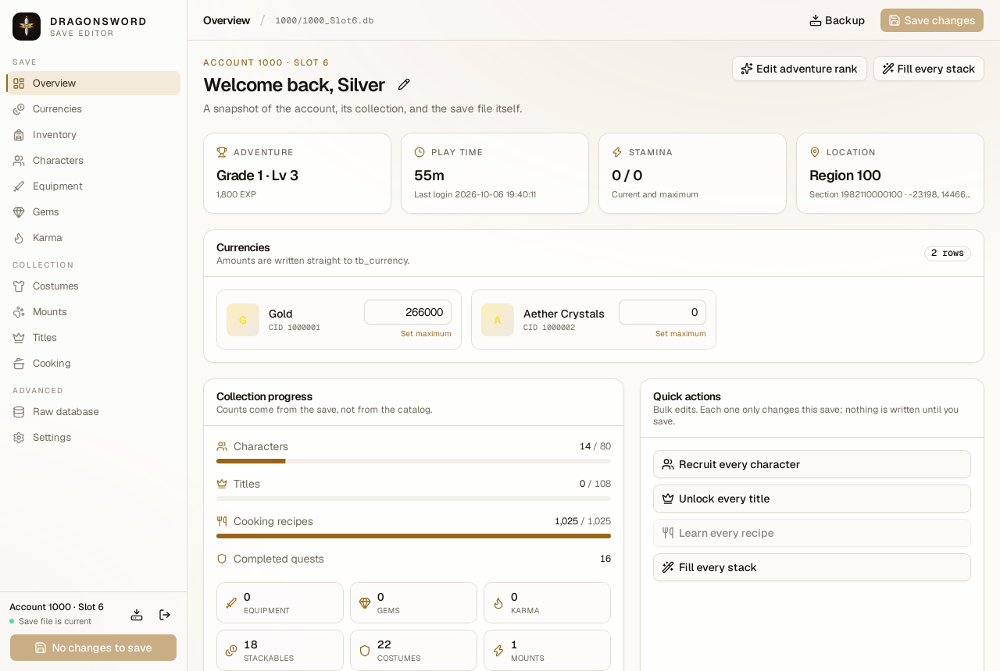

# DragonSword Save Editor

A local desktop save editor for **DragonSword Awakening (2026)**. It opens the game's encrypted SQLCipher save, exposes the data as typed screens, and writes the file back in the format the game expects — with a timestamped backup before the first write.



## Features

| Feature                     | What it does                                                                                                                                                                                                                                                                |
| --------------------------- | --------------------------------------------------------------------------------------------------------------------------------------------------------------------------------------------------------------------------------------------------------------------------- |
| **Save discovery**          | Scans a folder for `<account>_Slot<N>.db` saves, shows the slot screenshot, and opens a file directly.                                                                                                                                                                      |
| **Overview and rename**     | Account, player name, adventure rank and level, EXP, play time, stamina, location, collection progress, and save file metadata. Rename the player.                                                                                                                          |
| **Currencies**              | Edit gold and aether crystals, or fill either with the editor's maximum in one click.                                                                                                                                                                                       |
| **Inventory**               | Edit stack counts, add a missing stackable from the catalog, or fill every stack to a chosen count.                                                                                                                                                                         |
| **Characters**              | Edit level, EXP, ascension, HP, transcendence, and soldier grade, remove characters, manage skills, and fill team slots. Recruiting is switched off until the roster is verified.                                                                                           |
| **Equipment**               | Edit enchant level, item EXP, lock state, the linked gem (by 64-bit instance id), and raw main/sub stat CIDs and values.                                                                                                                                                    |
| **Gems**                    | Edit each gem's raw stat CID and lock state.                                                                                                                                                                                                                                |
| **Karma**                   | Edit EXP, ascension, and transcendence, and equip a spirit to a character; the previous owner's slot is cleared.                                                                                                                                                            |
| **Costumes and mounts**     | Unlock catalog entries, equip them per character, and toggle costume parts and new-item flags.                                                                                                                                                                              |
| **Titles**                  | Browse all 108 titles with their colour and stat bonus, unlock them individually or all at once, and keep existing favourites intact.                                                                                                                                       |
| **Cooking**                 | Browse all 1,025 recipes with ingredients and effects, toggle known state, or learn every recipe.                                                                                                                                                                           |
| **Raw database**            | Browse every table, search every column, page through rows, inspect the schema, and edit one type-checked cell at a time. Key and link columns stay locked until advanced editing is turned on.                                                                             |
| **Preferences**             | Light, dark, or system theme; English or French catalog; compact rows; show or hide unknown items; save folder and backups.                                                                                                                                                 |
| **Safe writes**             | Nothing is written until you save. A write is refused if the file changed on disk since the editor opened or last wrote it, or if the game left a journal or WAL beside the slot; otherwise the on-disk file is backed up, re-encrypted, verified, and atomically replaced. |
| **Offline and local-first** | No network, accounts, telemetry, or updates. Everything happens on your computer.                                                                                                                                                                                           |

## How it works

1. Point the editor at the folder that contains your save, or open a `.db` file directly.
2. Edit the data you care about. Changes stay in a private temporary database and the encrypted file is untouched.
3. Choose **Save changes** (or press <kbd>Ctrl</kbd>/<kbd>⌘</kbd> + <kbd>S</kbd>). The editor first checks that the file on disk is still the one it opened or last wrote, then backs it up, re-encrypts the database, verifies the round trip, and atomically replaces the original file.
4. Start the game and load the slot.

The editor never auto-saves and never modifies the sibling `SPack_SlotN.sav` or screenshot. Close the game before writing: a running game keeps the database open and can overwrite your changes. The [user guide](docs/guide.md) walks through each screen, backups, recovery, and troubleshooting.

## Save files

DragonSword Awakening stores each slot under the account folder:

```
.../DragonSword Awakening/DS/Saved/SaveGames/<accountId>/<accountId>_Slot<N>.db
```

Backups are written beside the save as `<save>.<timestamp>.bak`. To recover, close the editor, rename the backup over the save (or copy it back), and reopen the slot in the game.

## Requirements

- Windows 10/11, macOS 12 or newer, or Linux with WebKitGTK 4.1.
- To build from source: Node.js 24, pnpm 12, Rust 1.96 or newer, and the [Tauri prerequisites](https://v2.tauri.app/start/prerequisites/) for your platform.

## Development

```bash
pnpm install
pnpm desktop        # Vite + Tauri development window
pnpm check          # Biome, TypeScript, frontend tests, production build, Rust fmt/clippy/tests
pnpm desktop:build  # installers and bundles
```

The Rust workspace is split into `crates/core` (save format, catalog, and editing engine) and `apps/desktop/src-tauri` (Tauri commands and window). The React frontend lives in `apps/desktop/src`.

See [development](docs/development.md) for the repository layout, testing, and packaging notes.

## Save format

The save is an SQLCipher v4 database: AES-256-CBC, 4096-byte pages, PBKDF2-HMAC-SHA512 with 256,000 iterations, and a per-page HMAC-SHA512. The game uses one shared passphrase, so the editor can open any save without asking for a key.

The [save format reference](docs/save-format.md) documents the page layout, key derivation, schema, title and recipe bitmasks, 64-bit instance IDs, and the write pipeline.

## Limitations

- Recruiting is disabled in this build. There is no verified character roster yet: the bundled catalog's character category mixes playable characters with character items and skins, and the game's new-account seed is not a roster. Removing characters, editing an existing character, and the raw editor still work.
- Equipment and gem stat CIDs are exposed as raw numbers because the game's stat type table is not published. The editor can change the numbers but cannot name the stat; copy values from an item that already has the effect you want.
- New costume and mount instances are minted with random nonzero 32-bit IDs stored in the 64-bit columns, matching the range seen in real saves. The editor writes and reopens them, but this is not an official creation path.
- The editor is tested against saves from the current game build. A game update can change the schema; unknown columns are preserved, and the raw database browser is there when a typed screen does not cover a field.
- This is an unofficial fan tool, not affiliated with the game's developer or publisher. Editing saves can break progress; keep the backups.
